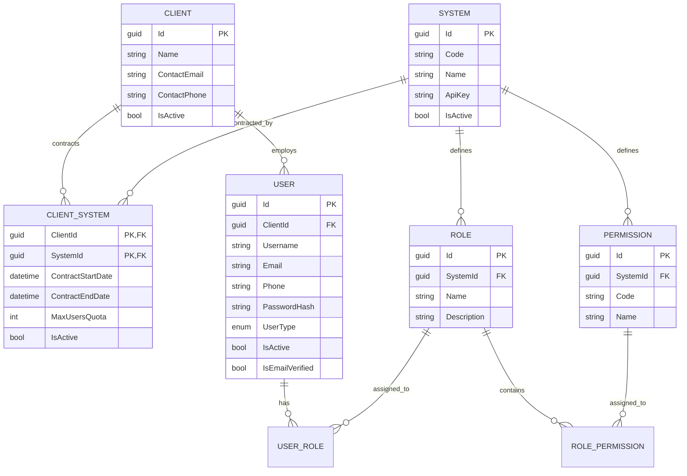

# 🛡️ Enterprise Identity & Access Management Layer (IdentityAuthLayer)

نظام متكامل لإدارة الهوية والوصول للمؤسسات والشركات متعددة المستأجرين (**Multi-Tenant Enterprise IAM**)، مبني وفق أعلى معايير هندسة البرمجيات (**Clean Architecture**, **CQRS**, **Domain-Driven Design**) باستخدام **.NET 8** و **Entity Framework Core** و **SQL Server**.

النظام مصمم ليعمل كـ **طبقة هوية وأمان مركزية (Centralized IAM)** تخدم وتدير وتتحقق من صلاحيات مستخدمي عدة أنظمة فرعية مستقلة (مثل: **نظام التراكينج / Tracking System**، **نظام إدارة الحج / Hajj Management**، **نظام المعاقين / Disability Services**، وغيرها).

---

## 🌟 أبرز مميزات النظام (Key Features)

### 1. تعدد المستأجرين والعزل التام (Multi-Tenancy & Tenant Isolation)
* **دعم الشركات والمؤسسات (Clients):** كل مستخدم ينتمي لشركة معينة (`ClientId`).
* **عزل الصلاحيات الإدارية (GroupAdmin Scoping):** مدير الشركة (`GroupAdmin`) يرى ويدير مستخدمي شركته فقط، ويُمنع برمجياً من رؤية أو تعديل أو إسناد أدوار لأي مستخدم يتبع شركة أخرى.
* **إدارة النظام العليا (Admin):** صلاحية كاملة على مستوى المنظومة لإنشاء الشركات والأنظمة والعقود.

### 2. إدارة العقود والحصص للأنظمة الفرعية (Contracts & Quotas)
* **تعاقدات الشركات مع الأنظمة (`ClientSystems`):** يتم تحديد الأنظمة التي تشترك بها كل شركة.
* **صلاحية وسريان العقد:** تاريخ بداية ونهاية لكل اشتراك (`ContractStartDate`, `ContractEndDate`).
* **كوتا المستخدمين (`MaxUsersQuota`):** تحديد حد أقصى لعدد المستخدمين المسموح بربطهم بكل نظام فرعي، مع فحص آلي يمنع تجاوز الكوتا المتعاقد عليها.

### 3. الصلاحيات المرتبطة بالأنظمة الفرعية (System-Scoped RBAC)
* كل دور (`Role`) وكل صلاحية (`Permission`) يتبعان نظاماً محدداً (`SystemId`).
* **منع التضارب:** يمكن لليوزر أن يمتلك صلاحية بنفس الاسم (مثل `VIEW_REPORTS`) على نظام التراكينج وعلى نظام الحج، ولكن كل صلاحية مفصولة ومعزولة تماماً بحسب النظام.

### 4. تكامل الأنظمة عبر السيرفرات (Machine-to-Machine / M2M Integration)
* **مفاتيح الأنظمة (`ApiKey`):** يتم توليد مفتاح مشفر لكل نظام فرعي (`SYS_KEY_<guid>`).
* **فحص الصلاحيات السريع:** يمكن لأي نظام فرعي الاستعلام عن صلاحيات مستخدميه عبر:
  * `GET /api/v1/Users/{userId}/permissions?systemId=...`
  * `GET /api/v1/Users/{userId}/permissions/check?systemId=...&permissionCode=...`
* **الحماية المتبادلة (Cross-System Snooping Prevention):** منع أي نظام فرعي من استخدام مفتاحه للاستعلام عن صلاحيات نظام آخر.

### 5. دورة التسجيل والأمان المتقدم (Auth & Security Lifecycles)
* **التسجيل الذاتي والتحقق الثنائي (2FA via Email OTP):** توليد كود تفعيل من 6 أرقام وإرساله عبر **SendGrid API**.
* **إنشاء وتشفير كلمات المرور:** تشفير آمن باستخدام **PBKDF2 (Rfc2898DeriveBytes)** مع Salt عشوائي فريد لكل مستخدم.
* **جلسات التوثيق المزدوجة (JWT Access & Refresh Tokens):** دعم تجديد الجلسات (`Refresh Token`) وإلغاء تسجيل الدخول (`Logout`).
* **الحماية من الهجمات:** حظر مؤقت للحسابات بعد 5 محاولات دخول فاشلة (`Account Lockout`) وتحديد معدل الطلبات (`Rate Limiting`).

---

## 🏗️ هيكلية المشروع (Clean Architecture)

تم تقسيم المشروع إلى 5 طبقات منفصلة لضمان استقلالية كود الأعمال وسهولة الصيانة والاختبار:

```text
IdentityAuthLayer/
│
├── src/
│   ├── Domain/                 # كيانات النظام وقواعد الدومين (Core Entities & Enums)
│   │   ├── Entities/           # Client, SystemEntity, ClientSystem, User, Role, Permission...
│   │   └── Enums/              # UserType (Admin, GroupAdmin, User)
│   │
│   ├── Application/            # منطق الأعمال وحالات الاستخدام (CQRS & MediatR)
│   │   ├── Auth/               # Commands: Register, VerifyAccount, CreatePassword, Login...
│   │   ├── Clients/            # CRUD العملاء وعقود الأنظمة والكوتا
│   │   ├── Systems/            # CRUD الأنظمة الفرعية ومفاتيح الـ ApiKey
│   │   ├── Roles/              # CRUD الأدوار وربط الصلاحيات
│   │   ├── Permissions/        # CRUD الصلاحيات
│   │   ├── Users/              # CRUD المستخدمين وإسناد الأدوار والاستعلام عن الصلاحيات
│   │   └── Common/             # Interfaces, Behaviors, DTOs
│   │
│   ├── Infrastructure/         # البنية التحتية والبيانات والتكامل الخارجي
│   │   ├── Persistence/        # EF Core DbContext, Repositories, Unit of Work, Migrations
│   │   ├── Identity/           # JwtTokenService, PasswordHasher, AuthSecurity
│   │   └── Email/              # SendGridEmailService, SmtpEmailService
│   │
│   ├── SharedModels/           # النماذج المشتركة وشكل الرد الموحد
│   │   ├── ResponseManager/    # Result, Result<T>
│   │   └── Responses/          # ApplicationResponse<T>, ResponseHandler
│   │
│   └── API/                    # واجهة الويب والـ Controllers والـ Middleware
│       ├── Controllers/        # Auth, Clients, Systems, Roles, Permissions, Users
│       ├── Routes/             # مسارات الـ API المركزية
│       └── Program.cs          # DI, Swagger, JWT, RateLimiting, CORS
│
└── IdentityAuthLayer.sln
```

---

## 🗄️ المخطط البياني للعلاقات (Entity Relationship Diagram)



---

## 📋 دليل الـ Endpoints (API Reference)

### 1. المصادقة والحسابات (`/api/v1/Auth`)
| Method | Endpoint | Description |
| :--- | :--- | :--- |
| `POST` | `/api/v1/Auth/register` | تسجيل حساب جديد لمستخدم تابع لشركة (إرسال كود OTP) |
| `POST` | `/api/v1/Auth/verify-account` | تفعيل الحساب بكود الـ OTP المرسل على الإيميل |
| `POST` | `/api/v1/Auth/resend-verification-code` | إعادة إرسال كود التحقق |
| `POST` | `/api/v1/Auth/create-password` | إنشاء كلمة المرور بعد تفعيل الحساب |
| `POST` | `/api/v1/Auth/login` | تسجيل الدخول واستلام Access Token و Refresh Token |
| `POST` | `/api/v1/Auth/refresh-token` | تجديد الـ Access Token المنتهي |
| `POST` | `/api/v1/Auth/forgot-password` | طلب كود إعادة تعيين كلمة المرور |
| `POST` | `/api/v1/Auth/verify-reset-code` | التحقق من كود استعادة كلمة المرور |
| `POST` | `/api/v1/Auth/reset-password` | تعيين كلمة المرور الجديدة |
| `POST` | `/api/v1/Auth/logout` | تسجيل الخروج وإبطال الـ Refresh Token |
| `GET` | `/api/v1/Auth/check-email` | التحقق من وجود إيميل وحالته مسبقاً |

### 2. إدارة العملاء والشركات (`/api/v1/Clients`)
| Method | Endpoint | Description |
| :--- | :--- | :--- |
| `GET` | `/api/v1/Clients` | استعراض جميع الشركات والأنظمة المتعاقد عليها |
| `GET` | `/api/v1/Clients/{clientId}` | تفاصيل شركة محددة وعقودها وحصصها |
| `POST` | `/api/v1/Clients` | إنشاء شركة / عميل جديد |
| `PUT` | `/api/v1/Clients/{clientId}` | تعديل بيانات الشركة |
| `POST` | `/api/v1/Clients/{clientId}/toggle-active` | تجميد أو تنشيط حساب الشركة بالكامل |
| `POST` | `/api/v1/Clients/{clientId}/systems` | ربط شركة بنظام وتحديد فترات العقد وكوتا المستخدمين |
| `DELETE` | `/api/v1/Clients/{clientId}/systems/{systemId}` | إلغاء تعاقد شركة مع نظام محدد |
| `POST` | `/api/v1/Clients/{clientId}/systems/{systemId}/toggle-active` | تجميد أو تنشيط اشتراك نظام مؤقتاً |

### 3. إدارة الأنظمة الفرعية (`/api/v1/Systems`)
| Method | Endpoint | Description |
| :--- | :--- | :--- |
| `GET` | `/api/v1/Systems` | استعراض جميع الأنظمة ومفاتيح الـ ApiKey الخاصة بها |
| `GET` | `/api/v1/Systems/{systemId}` | تفاصيل نظام محدد |
| `POST` | `/api/v1/Systems` | تسجيل نظام فرعي جديد وتوليد الـ ApiKey تلقائياً |
| `PUT` | `/api/v1/Systems/{systemId}` | تعديل بيانات النظام |
| `POST` | `/api/v1/Systems/{systemId}/toggle-active` | تفعيل أو تعطيل النظام |

### 4. الأدوار والصلاحيات (`/api/v1/Roles` & `/api/v1/Permissions`)
| Method | Endpoint | Description |
| :--- | :--- | :--- |
| `GET` | `/api/v1/Roles?systemId=...` | استعراض الأدوار (مع فلترة اختيارية بالنظام) |
| `POST` | `/api/v1/Roles` | إنشاء دور جديد مربوط بنظام فرعي |
| `PUT` | `/api/v1/Roles/{roleId}` | تعديل الدور |
| `DELETE` | `/api/v1/Roles/{roleId}` | حذف الدور نهائياً وفك ارتباطاته |
| `POST` | `/api/v1/Roles/{roleId}/permissions` | ربط صلاحية بدور (شرط تطابق النظام) |
| `DELETE` | `/api/v1/Roles/{roleId}/permissions/{permissionId}` | سحب صلاحية من دور |
| `GET` | `/api/v1/Permissions?systemId=...` | استعراض الصلاحيات |
| `POST` | `/api/v1/Permissions` | إنشاء صلاحية جديدة لنظام |
| `PUT` | `/api/v1/Permissions/{permissionId}` | تعديل صلاحية |
| `DELETE` | `/api/v1/Permissions/{permissionId}` | حذف صلاحية نهائياً |

### 5. إدارة المستخدمين والصلاحيات (`/api/v1/Users`)
| Method | Endpoint | Description |
| :--- | :--- | :--- |
| `GET` | `/api/v1/Users` | استعراض المستخدمين (معزول لمدير الشركة) |
| `GET` | `/api/v1/Users/me` | الملف الشخصي للمستخدم الحالي مسجل الدخول |
| `POST` | `/api/v1/Users/change-password` | تغيير كلمة المرور للمستخدم الحالي |
| `GET` | `/api/v1/Users/{userId}` | استعراض بيانات مستخدم محدد |
| `POST` | `/api/v1/Users` | إضافة مستخدم جديد مباشرة |
| `PUT` | `/api/v1/Users/{userId}` | تعديل بيانات مستخدم |
| `POST` | `/api/v1/Users/{userId}/toggle-active` | تجميد أو تنشيط مستخدم |
| `POST` | `/api/v1/Users/{userId}/roles` | ربط دور بمستخدم (مع فحص سريان العقد والكوتا) |
| `DELETE` | `/api/v1/Users/{userId}/roles/{roleId}` | سحب دور من مستخدم |
| `GET` | `/api/v1/Users/{userId}/permissions` | جلب كافة صلاحيات المستخدم على نظام محدد |
| `GET` | `/api/v1/Users/{userId}/permissions/check` | فحص امتلاك المستخدم لصلاحية معينة على نظام |

---

## ⚙️ متطلبات التشغيل والتثبيت (Getting Started)

### المتطلبات الأساسية (Prerequisites)
1. **.NET 8 SDK** مثبت على جهازك.
2. **Microsoft SQL Server** (أو SQL Server Express / LocalDB).

### خطوات الإعداد:
1. **استنساخ المستودع (Clone Repository):**
   ```bash
   git clone https://github.com/ebrahim-saber/Auth-Identity-Layers.git
   cd Auth-Identity-Layers
   ```

2. **ضبط الإعدادات (`appsettings.json`):**
   افتح `src/API/appsettings.json` وتأكد من سلسلة الاتصال وإعدادات البريد:
   ```json
   {
     "ConnectionStrings": {
       "DefaultConnection": "Server=.;Database=IdentityAuthLayerDb;Trusted_Connection=True;TrustServerCertificate=True;MultipleActiveResultSets=true"
     },
     "SendGridSettings": {
       "ApiKey": "YOUR_SENDGRID_API_KEY",
       "SenderEmail": "your-email@example.com",
       "SenderName": "Identity Auth Layer"
     }
   }
   ```

3. **تطبيق قاعدة البيانات (Database Migrations):**
   يقوم المشروع بتطبيق الـ Migrations تلقائياً عند التشغيل لأول مرة، أو يمكنك تطبيقها يدوياً:
   ```bash
   dotnet ef database update --project src/Infrastructure --startup-project src/API
   ```

4. **تشغيل المشروع (Run):**
   ```bash
   dotnet run --project src/API --launch-profile http
   ```

5. **فتح واجهة Swagger التفاعلية:**
   توجه إلى المتصفح على الرابط:
   ```text
   http://localhost:5080/swagger
   ```

---

## 👨‍💻 المساهمة والتطوير (Contribution)
المشروع مفتوح للمساهمات والتطويرات. لا تتردد في فتح Issues أو Pull Requests لتحسين وتوسيع المنظومة.
